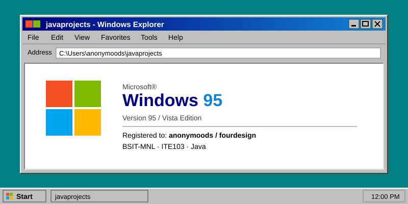

<p align="center">  </p>

```
⠀⠀⠀⠀      ⣀⣠⣤⠶⠶⠶⠶⠶⢦⣤⣀⡀⠀⠀⠀⠀⠀⠀⠀⠀⠀
⠀⠀⠀⠀⠀⠀⣠⡶⠛⠋⠀⠀⠀⠀⠀⠀⠀⠀⠀⠈⠙⠛⢦⣄⠀⠀⠀⠀⠀⠀
⠀⠀⠀⠀⣰⠞⠁⠀⠀⠀⠀⠀⠀⠀⠀⠀⠀⠀⠀⠀⠀⠀⠀⠉⠳⣄⠀⠀⠀⠀
⠀⠀⢠⡾⠁⠀⠀⢀⣤⣤⣤⣤⣄⠀⠀⠀⠀⠀⠀⠀⠀⣠⣤⣤⣤⡙⢷⡀⠀⠀
⠀⢠⡟⠀⠀⠀⣰⣿⣿⡇⠀⠀⠙⢷⡀⠀⠀⠀⠀⢠⣾⣿⣿⠀⠀⠹⣮⢿⡀⠀
⠀⣾⠀⠀⠀⢰⡏⠙⠛⠁⠀⠀⠀⠘⡇⠀⠀⠀⠀⣸⠋⠛⠋⠀⠀⠀⢹⠈⣧⠀
⢸⡇⠀⠀⠀⠘⣧⣤⣤⣤⣤⣤⣤⣤⡇⠀⠀⠀⠀⢸⣧⣤⣤⣤⣤⣤⣾⠀⢹⡆
⢸⠀⠀⠀⠀⠀⠀⠀⠀⠀⠀⠀⠀⠀⠀⠀⠀⠀⠀⠀⠀⠀⠀⠀⠀⠀⠀⠀⢸⡇
⢸⡇⠀⠀⠀⠀⣰⣶⣶⣶⣶⣶⣶⣶⣶⣶⣶⣶⣶⣶⣶⣶⣶⣶⣶⡶⠀⠀⣸⠇
⠀⣿⠀⠀⠀⠀⣿⣿⣿⣿⣿⣿⣿⣿⣿⣿⣿⣿⣿⣿⣿⣿⣿⣿⣿⠁⠀⢀⡟⠀
⠀⠘⣧⠀⠀⠀⢻⣿⣿⣿⣿⣿⣿⣿⣿⣿⣿⣿⣿⣿⣿⣿⣿⣿⠃⠀⠀⣾⠁⠀
⠀⠀⠘⢷⡀⠀⠀⢻⣿⡻⠋⠁⠀⠀⠀⠉⠻⣿⣿⣿⣿⣿⡿⠃⠀⢠⡾⠁⠀⠀
⠀⠀⠀⠀⠻⣦⡀⠀⠙⠷⣤⣀⠀⠀⠀⠀⠀⠈⣿⣿⡿⠋⠀⣀⡴⠋⠀⠀⠀⠀
⠀⠀⠀⠀⠀⠀⠙⠷⣤⣀⠀⠉⠛⠓⠒⠒⠒⠚⠋⠁⣠⣤⠾⠋⠀⠀⠀⠀⠀⠀
⠀⠀⠀⠀⠀⠀⠀⠀⠀⠉⠙⠛⠶⠶⠶⠶⠶⠶⠛⠋⠉⠀⠀⠀⠀ 

# 📂C:/Users/anonymoods/javaprojects/anonymoods.txt
---
``
 ⠀⠀⠀⠀⠀                           ⠀⠀  ┌──────────────────────────────────────────────────────┐
                                      │ 🪟 anonymoods - Notepad                        _ □ X |  
                                      ├──────────────────────────────────────────────────────┤
                                      │ File   Edit   View   Favorites   Tools   Help        │
                                      ├──────────────────────────────────────────────────────┤
                                      │ hello, and welcome to my epic github page =D,        |
                                      │ i am anonymoods, a college student studying BSIT-MNL |
                                      | and these are my epic coding journey xD              |
                                      │                                                      │
                                      │                                                      │
                                      └──────────────────────────────────────────────────────┘
 ```
---
## 📂 C:/Users/anonymoods/javaprojects/Midterm Projects
---
### 📂 C:/Users/anonymoods/javaprojects/Midterm Projects/Midterm Task 1
📄 [Midterm Task 1](https://github.com/anonymoods-design/javaprojects/blob/main/Midterm%20Projects/Lab%20Task%201%3A%20Matrix)
\
📄 [Documentation](https://github.com/anonymoods-design/javaprojects/blob/main/Midterm%20Projects/MidtermTask1_Villanueva_Paul_Henrick_M.pdf)

### 📂 C:/Users/anonymoods/javaprojects/Midterm Projects/Midterm Task 2
📄 [Midterm Task 2](https://github.com/anonymoods-design/javaprojects/blob/main/Midterm%20Projects/Lab%20Task%202%3A%20Average)
\
📄 [Documentation](https://github.com/anonymoods-design/javaprojects/blob/main/Midterm%20Projects/MidtermTask2_Villanueva_Paul_Henrick_M.pdf)

